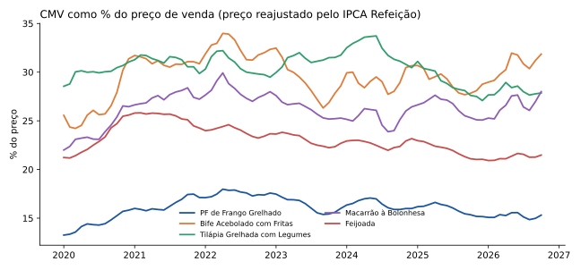
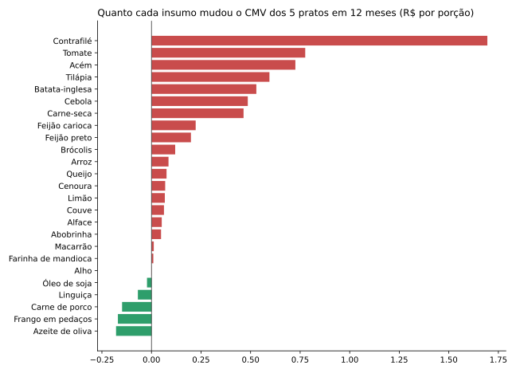
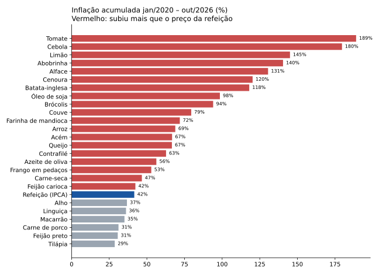
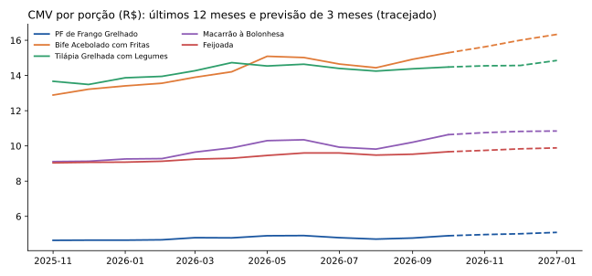

# 📈 Radar de Custos para Restaurantes

> Quanto a inflação dos insumos está comendo da margem de cada prato?

O **Radar de Custos** cruza a inflação oficial (**IPCA/IBGE**) de **25 insumos** com as **fichas técnicas de 5 pratos** de um restaurante. Ele mede como a alta de preços mexe no **CMV** (custo da mercadoria vendida) e na margem de cada prato, e prevê os **próximos 3 meses**.

Projeto de portfólio da [Vexo AI2](https://vexoai2.app), feito por quem passou 20 anos na gestão de restaurantes e hoje trabalha com dados.

**Dados:** IPCA mensal de jan/2020 a out/2026 · **Stack:** Python · SQL · Power BI

---

## 🎯 Problema de negócio

No food service, o cardápio é precificado uma vez e os insumos sobem todo mês. Quem reajusta o cardápio "pela inflação" usa uma média. Só que a inflação do **seu** prato pode ser bem diferente dessa média, e a diferença sai da margem.

Perguntas que o projeto responde:

1. Quais insumos mais subiram e quais mais pesaram no custo dos pratos?
2. Quanto o CMV de cada prato variou em 12 meses?
3. Reajustando o preço só pela inflação da refeição fora de casa, qual prato perde margem?
4. O que esperar para os próximos 3 meses?

## 📊 Principais resultados (out/2025 → out/2026)

| Prato | CMV out/25 | CMV out/26 | Variação do CMV | CMV % do preço (out/25 → out/26) |
|---|---|---|---|---|
| Bife Acebolado com Fritas | R$ 12,72 | R$ 15,29 | **+20,2%** | 27,8% → **31,9%** |
| Macarrão à Bolonhesa | R$ 9,16 | R$ 10,64 | **+16,2%** | 25,3% → **28,0%** |
| Feijoada | R$ 9,04 | R$ 9,67 | +7,0% | 21,1% → 21,5% |
| Tilápia Grelhada com Legumes | R$ 13,67 | R$ 14,48 | +5,9% | 27,6% → 27,9% |
| PF de Frango Grelhado | R$ 4,68 | R$ 4,90 | +4,7% | 15,4% → 15,3% |

No mesmo período, o **IPCA geral subiu 4,6%** e o IPCA de **Refeição** (preço da comida fora de casa) **subiu 5,0%**.

**Insights**

- **O bife e a bolonhesa estão perdendo margem.** O CMV deles subiu 3 a 4 vezes mais que o preço da refeição. Um restaurante que reajustou o cardápio só pela inflação do setor perdeu **4,0 p.p.** de margem no bife e **2,7 p.p.** na bolonhesa.
- **Quem mais pesou em reais: contrafilé, tomate e acém.** Em percentual, os campeões foram **cebola (+108%)**, **tomate (+63%)**, **limão (+60%)** e **batata (+54%)**.
- **Houve alívio em parte dos insumos:** azeite (−13,7%), carne de porco (−7,2%), frango (−5,6%) e óleo de soja (−4,2%). Por isso o PF de frango ficou estável.
- **No longo prazo, o hortifrúti é o grande vilão.** Desde jan/2020, tomate subiu 189% e cebola 180%, contra 42% da refeição.
- **Previsão até jan/2027:** o CMV do bife deve subir mais **6,8%**. Os outros pratos sobem de 2% a 4%.

<p align="center"></p>
<p align="center"></p>
<p align="center"></p>
<p align="center"></p>

## 🧾 Dados

| Arquivo | Conteúdo | Fonte |
|---|---|---|
| `data/raw/ipca_subitens_mensal.csv` | Variação mensal (%) de 25 subitens do IPCA, índice geral e Refeição | IBGE/SIDRA, tabela 7060 |
| `data/insumos.csv` | Insumos, código SIDRA e preço de referência (out/2026) | Premissa do projeto |
| `data/fichas_tecnicas.csv` | Quantidade de cada insumo por porção | Premissa do projeto |
| `data/pratos.csv` | Preço de venda de referência (out/2026) | Premissa do projeto |

## 🔄 Metodologia

1. **Coleta** (`src/coleta_ipca.py`): baixa as séries da API do SIDRA/IBGE.
2. **Número-índice**: transforma as variações mensais em um índice acumulado por insumo.
3. **Preço mês a mês**: parte do preço de referência de out/2026 e reconstrói o histórico pelo índice do insumo. O preço de venda segue o IPCA de Refeição.
4. **CMV em SQL** (`sql/cmv.sql`): CMV por prato, CMV % do preço, composição do custo e impacto de cada insumo em 12 meses.
5. **Previsão de 3 meses**: três métodos testados em *backtest* com 24 pontos de partida. Venceu a **mediana sazonal** (variação típica de cada mês do ano), com erro médio de **3,2 p.p.** na variação do CMV, contra 4,1 p.p. de "sem variação" e 4,4 p.p. da "média dos últimos 12 meses".
6. **Power BI** (`powerbi/`): tabelas em modelo estrela, medidas DAX e layout sugerido.

## ▶️ Como rodar

```bash
pip install -r requirements.txt
python src/coleta_ipca.py   # atualiza os dados do IBGE (opcional)
python src/pipeline.py      # gera outputs/, powerbi/ e img/
```

Para usar com o seu restaurante, troque os preços em `data/insumos.csv`, as fichas em `data/fichas_tecnicas.csv` e os preços de venda em `data/pratos.csv`.

## 📁 Estrutura

```
├── data/          # IPCA bruto + premissas (insumos, fichas técnicas, pratos)
├── src/           # coleta_ipca.py, pipeline.py
├── sql/           # cmv.sql
├── outputs/       # resultados em CSV
├── powerbi/       # modelo estrela + medidas DAX + guia do painel
└── img/           # gráficos
```

## ⚠️ Limitações

- O IPCA mede o **preço ao consumidor**, na média do Brasil. O preço de atacado e o da sua região podem variar diferente.
- Preços, fichas técnicas e preços de venda são **premissas ilustrativas**: um restaurante-modelo, não um negócio real.
- As fichas técnicas são fixas no tempo: o modelo não considera troca de fornecedor nem ajuste de porção.
- A previsão é estatística simples. Ela não antecipa choques como clima ou câmbio.

## 👩‍💻 Autora

**Larissa Lourenço**, Tecnóloga em Gestão de Gastronomia e fundadora da Vexo AI2
[LinkedIn](https://www.linkedin.com/in/larissalourenco-vexoai2/) · [vexoai2.app](https://vexoai2.app)
